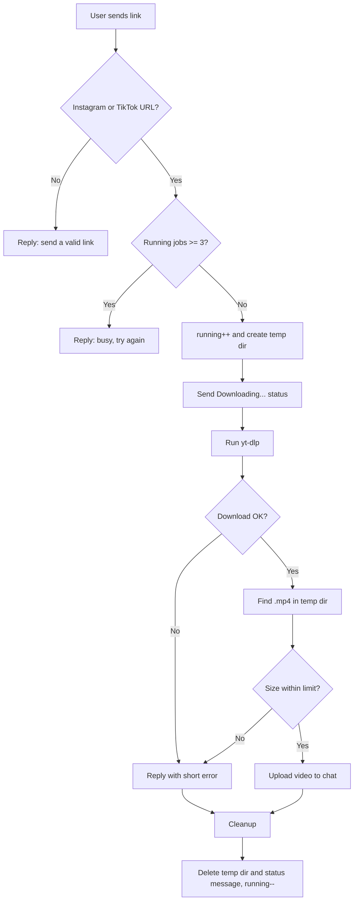
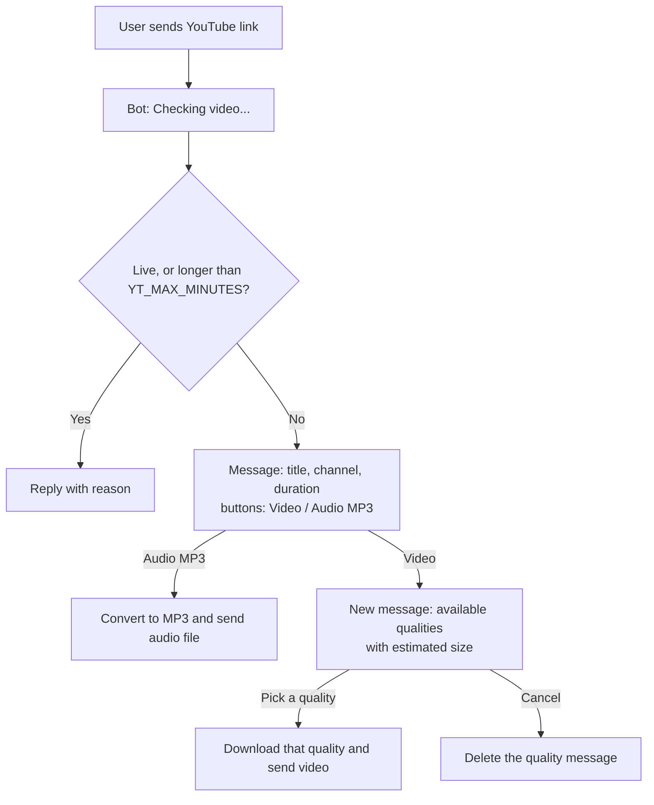

# TRD Bot

A Telegram bot that downloads **Instagram Reels**, **TikTok** and **YouTube** videos in high quality, **without watermark**, and sends them back in chat.

Stack: **Node.js** · **Telegraf** · **yt-dlp** · **ffmpeg**

---

## Table of Contents

1. [How It Works](#1-how-it-works)
2. [Request Flow](#2-request-flow)
3. [Step 1: Create the Bot in BotFather](#3-step-1-create-the-bot-in-botfather)
4. [Step 2: Install Prerequisites](#4-step-2-install-prerequisites)
5. [Step 3: Set Up the Project](#5-step-3-set-up-the-project)
6. [Step 4: Run and Test](#6-step-4-run-and-test)
7. [Using the Bot](#7-using-the-bot)
8. [Configuration](#8-configuration)
9. [Instagram Cookies (Optional)](#9-instagram-cookies-optional)
10. [Lifting the 50 MB Limit (Optional)](#10-lifting-the-50-mb-limit-optional)
11. [Deploy 24/7](#11-deploy-247)
12. [Maintenance](#12-maintenance)
13. [Troubleshooting](#13-troubleshooting)
14. [Security and Legal](#14-security-and-legal)
15. [Ideas for Extensions](#15-ideas-for-extensions)
16. [Usage Tracking and Google Sheets](#16-usage-tracking-and-google-sheets)
17. [YouTube Support](#17-youtube-support)

---

## 1. How It Works

The bot does no scraping itself. It is a thin wrapper around proven tools:

| Component | Role |
|-----------|------|
| **Telegram** | Delivers user messages to the bot and receives the video back |
| **Telegraf** (`bot.js`) | Receives messages, validates links, runs the download, uploads the result |
| **yt-dlp** | Finds the real video stream on Instagram/TikTok and downloads it |
| **ffmpeg** | Merges separate video and audio streams into one `.mp4` |

**No watermark:** yt-dlp requests the platform's clean stream. For TikTok this is the original video, not the "share" version with the logo. Instagram Reels carry no watermark at the source.

**High quality:** the format selector asks for the best H.264 video plus AAC audio and merges them without re-encoding.

---

## 2. Request Flow



**Step by step**

1. **Receive:** the user sends a text message and Telegraf's `bot.on('text')` handler fires.
2. **Validate:** the message is matched against a regex for `instagram.com` and `tiktok.com` (including `vm.tiktok.com`, `vt.tiktok.com`).
3. **Throttle:** if 3 downloads are already running (`MAX_PARALLEL`), the request is rejected.
4. **Prepare:** a unique temp folder is created and a "Downloading..." message is sent.
5. **Download:** `yt-dlp` runs with a 120 s timeout and saves `<video-id>.mp4`.
6. **Check:** the file size is compared to the limit (50 MB normally, 2 GB with a local Bot API server).
7. **Send:** the video is uploaded with `supports_streaming: true`, so it plays inline.
8. **Cleanup (always):** the temp folder and status message are deleted and the counter is decremented, on success and on failure.

---

## 3. Step 1: Create the Bot in BotFather

1. Open Telegram and search for **@BotFather** (the one with the blue verified tick).
2. Send `/start`, then `/newbot`.
3. **Name:** when BotFather asks "How are we going to call it?", send:
   ```
   TRD Bot
   ```
4. **Username:** BotFather asks for a username. It must be **unique, end in `bot`**, and use only letters, numbers and underscores. If one is taken, try another:
   ```
   TRD_Downloader_bot
   trd_reels_bot
   TRDDownloadBot
   ```
5. BotFather replies with your **HTTP API token**, which looks like `123456789:ABCdefGhIJKlmNoPQRsTUVwxyZ`. Copy it and keep it secret.

### Recommended BotFather settings

Send these commands to BotFather and pick "TRD Bot" when asked:

| Command | What to send |
|---------|--------------|
| `/setdescription` | `Download Instagram Reels and TikTok videos without watermark, in high quality. Just send a link.` |
| `/setabouttext` | `TRD Bot: send an Instagram or TikTok link, get the video back.` |
| `/setcommands` | `start - Start the bot` |
| `/setuserpic` | Upload a profile picture (optional) |
| `/setjoingroups` | `Disable` if you don't want others adding it to groups |

> If your token ever leaks (screenshot, public repo), send `/revoke` to BotFather to generate a new one and update `.env`.

---

## 4. Step 2: Install Prerequisites

You need **Node.js 18+**, **Python 3** (for yt-dlp), **yt-dlp**, and **ffmpeg**.

### Windows (PowerShell)

```powershell
winget install OpenJS.NodeJS.LTS
winget install Python.Python.3.12
winget install yt-dlp.yt-dlp
winget install Gyan.FFmpeg
```

Close and reopen PowerShell, then verify:

```powershell
node -v
yt-dlp --version
ffmpeg -version
```

### macOS

```bash
brew install node yt-dlp ffmpeg
```

### Linux (Ubuntu/Debian)

```bash
sudo apt update && sudo apt install -y nodejs npm ffmpeg python3-pip
pip install -U yt-dlp --break-system-packages
```

All three verify commands (`node -v`, `yt-dlp --version`, `ffmpeg -version`) must print a version. If one says "not found", the tool is not on your PATH.

---

## 5. Step 3: Set Up the Project

```
trd-bot/
├── bot.js          # main bot logic
├── package.json    # dependencies (telegraf, dotenv)
├── .env            # your secrets (you create this)
├── .env.example    # template
└── .gitignore      # keeps .env and cookies out of Git
```

1. Open a terminal in the `trd-bot` folder.
2. Create your `.env` file from the template:

   **Windows:**
   ```powershell
   copy .env.example .env
   ```
   **macOS/Linux:**
   ```bash
   cp .env.example .env
   ```
3. Open `.env` and paste your token:
   ```
   BOT_TOKEN=123456789:ABCdefGhIJKlmNoPQRsTUVwxyZ
   ```
4. Install dependencies:
   ```bash
   npm install
   ```

---

## 6. Step 4: Run and Test

```bash
npm start
```

You should see `TRD Bot running`. Now:

1. Open your bot in Telegram (`t.me/<your_bot_username>`).
2. Press **Start**. You should get the welcome message.
3. Paste a public TikTok or Instagram Reel link.
4. Wait a few seconds: the bot shows "Downloading..." and then sends the video.

Stop the bot with `Ctrl + C`.

**Example links that work**

```
https://www.tiktok.com/@user/video/1234567890
https://vm.tiktok.com/ZMabcdef/
https://www.instagram.com/reel/AbCdEfGhIjK/
```

---

## 7. Using the Bot

| You send | Bot does |
|----------|----------|
| `/start` | Sends the welcome message |
| A TikTok link | Sends the video without watermark |
| An Instagram Reel link | Sends the Reel video |
| Anything else | Asks for a valid link |

The link can be inside a longer message. The bot extracts the first Instagram/TikTok URL it finds.

---

## 8. Configuration

### `.env`

| Variable | Required | Description |
|----------|----------|-------------|
| `BOT_TOKEN` | Yes | Token from BotFather |
| `COOKIES_FILE` | No | Path to a Netscape-format `cookies.txt` (see section 9) |
| `API_ROOT` | No | URL of a self-hosted Bot API server (see section 10) |

### Constants in `bot.js`

| Constant | Default | Meaning |
|----------|---------|---------|
| `MAX_PARALLEL` | `3` | Max simultaneous downloads |
| `MAX_BYTES` | 50 MB (2 GB with `API_ROOT`) | Max file size before upload |
| `handlerTimeout` | 5 min | Telegraf timeout per update |
| yt-dlp `timeout` | 120 s | Max time for one download |

### The yt-dlp format selector

```
bv*[vcodec^=avc1]+ba[acodec^=mp4a]/bv*+ba/b
```

`/` means "if that fails, try the next":

1. Best H.264 video + AAC audio (most compatible with Telegram and phones)
2. Best video + best audio of any codec, merged by ffmpeg
3. Best single pre-merged file

`--merge-output-format mp4` guarantees an `.mp4`, and `--no-playlist` prevents downloading many videos from one link.

---

## 9. Instagram Cookies (Optional)

Instagram sometimes blocks anonymous downloads ("login required" or rate-limit errors). Fix it with cookies:

1. Create or use a **throwaway Instagram account** (not your main one) and log in on your browser.
2. Install a "Get cookies.txt" browser extension.
3. Open instagram.com, click the extension, and export `cookies.txt`.
4. Save it in the project folder and set it in `.env`:
   ```
   COOKIES_FILE=./cookies.txt
   ```
5. Restart the bot.

Cookies expire, so re-export when downloads start failing again. Never commit `cookies.txt` (it is already in `.gitignore`).

---

## 10. Lifting the 50 MB Limit (Optional)

The public Bot API only accepts uploads up to **50 MB**. Most Reels and TikToks fit, but longer videos may not. To upload up to **2 GB**, run your own Bot API server:

1. Get `api_id` and `api_hash` from [my.telegram.org](https://my.telegram.org) (API development tools).
2. Build or run [telegram-bot-api](https://github.com/tdlib/telegram-bot-api). Docker example:
   ```bash
   docker run -d --name tg-api -p 8081:8081 \
     -e TELEGRAM_API_ID=YOUR_ID -e TELEGRAM_API_HASH=YOUR_HASH \
     aiogram/telegram-bot-api:latest
   ```
3. Log the bot out of the cloud API once by opening `https://api.telegram.org/bot<TOKEN>/logOut` in a browser.
4. Set in `.env`:
   ```
   API_ROOT=http://localhost:8081
   ```
5. Restart the bot.

---

## 11. Deploy 24/7

Running on your PC only works while it is on. For always-on hosting, use a small VPS (1 GB RAM is enough).

### Option A: pm2 (simple)

```bash
npm install -g pm2
pm2 start bot.js --name trd-bot
pm2 save
pm2 startup          # follow the printed command so it survives reboots
```

Useful commands:

```bash
pm2 logs trd-bot     # view logs
pm2 restart trd-bot  # restart after updating
pm2 stop trd-bot     # stop
```

### Option B: Docker

Create a `Dockerfile` next to `bot.js`:

```dockerfile
FROM node:20-slim
RUN apt-get update && apt-get install -y ffmpeg python3-pip \
    && pip install -U yt-dlp --break-system-packages \
    && rm -rf /var/lib/apt/lists/*
WORKDIR /app
COPY package*.json ./
RUN npm install --omit=dev
COPY . .
CMD ["node", "bot.js"]
```

Build and run:

```bash
docker build -t trd-bot .
docker run -d --name trd-bot --restart unless-stopped --env-file .env trd-bot
```

### Moving between machines with Git

`.env` and `cookies.txt` are ignored by Git on purpose. On each new machine, clone the repo, recreate `.env`, and run `npm install`.

---

## 12. Maintenance

**Keep yt-dlp updated.** TikTok and Instagram change often, and an outdated yt-dlp is the most common reason downloads break.

```bash
yt-dlp -U                     # or: pip install -U yt-dlp
```

Automate it on a Linux server with cron (weekly):

```bash
0 3 * * 0  pip install -U yt-dlp --break-system-packages
```

Temp files are deleted automatically after each request, so no manual cleanup is needed.

---

## 13. Troubleshooting

| Problem | Cause | Fix |
|---------|-------|-----|
| Bot doesn't reply at all | Wrong token, or the bot isn't running | Check `BOT_TOKEN` in `.env`, and check the terminal for errors |
| `401 Unauthorized` on start | Invalid or revoked token | Get a fresh token from BotFather (`/token`) |
| No "running" message in terminal | Old versions only logged after the bot stopped | Use the updated `bot.js`: it prints `TRD Bot is running as @username` on start |
| yt-dlp "not recognized" on Windows | PATH not refreshed in VS Code, or pip's Scripts folder not on PATH | Fully quit VS Code and reopen, or set `YTDLP_PATH` in `.env` to the full path of `yt-dlp.exe` |
| `yt-dlp: command not found` | Not installed or not on PATH | Reinstall (section 4), reopen the terminal |
| Video has no sound or won't merge | ffmpeg missing | Install ffmpeg and check `ffmpeg -version` |
| Instagram "login required" or rate-limit | Instagram blocks anonymous requests | Use cookies (section 9) |
| Was working, now fails | Platform changed its site | Update yt-dlp (section 12) |
| "Video is XX MB, over Telegram's limit" | Bot API upload cap is 50 MB | Use a local Bot API server (section 10) |
| Private account content | Needs login and follow access | Use cookies from an account that can view it |
| "Busy, try again in a moment" | 3 downloads already running | Wait, or raise `MAX_PARALLEL` in `bot.js` |
| `409 Conflict` when starting | Another copy of the bot is running with the same token | Stop the other instance |

Full error details are printed in the terminal (`console.error`).

---

## 14. Security and Legal

- **Never share or commit your bot token.** Anyone with it controls your bot. Revoke with `/revoke` if leaked.
- Never commit `.env` or `cookies.txt` (both are in `.gitignore`).
- Cookies give access to the account they came from, so use a throwaway account.
- Downloading content may violate Instagram's and TikTok's Terms of Service, and reposting other people's videos can infringe copyright. Use TRD Bot for personal use or your own content.

---

## 15. Ideas for Extensions

- Per-user rate limiting (N downloads per hour)
- Audio-only mode (`-x --audio-format mp3`)
- Allow-list of user IDs to keep the bot private
- Worker queue instead of a hard parallel cap
- Usage stats stored in PostgreSQL
- Support for more platforms (yt-dlp handles many)

---

## 16. Usage Tracking and Google Sheets

TRD Bot records who uses it and what they download, to the console and optionally to a Google Sheet.

### What gets logged

| Status | Meaning | Console | Google Sheet |
|--------|---------|:-------:|:------------:|
| `START` | User pressed /start | Yes | No |
| `REQUEST` | User sent a link | Yes | No |
| `SENT` | Video delivered (with size) | Yes | Yes |
| `FAILED` | Download failed (with reason) | Yes | Yes |

Times use your PC's local time in a simple format, e.g. `2026-09-30 08:50:12`.

Console example:

```
2026-09-30 08:50:12 | SENT | @username (123456789) First Last | https://www.tiktok.com/... | 4.2MB
```

### Google Sheet (optional, live)

The bot sends each record to a small Google Apps Script web app that adds a row to your sheet. No Google Cloud project or API keys are needed.

1. Create a new Google Sheet, named e.g. **TRD Bot Usage**.
2. Open **Extensions > Apps Script**, delete the sample code, and paste the contents of `google-apps-script.gs`.
3. Change `SECRET` to a long random string. Save.
4. Click **Deploy > New deployment**, choose type **Web app**, then set:
   - Execute as: **Me**
   - Who has access: **Anyone**
5. Click **Deploy**, approve the permissions (Advanced > Go to project > Allow), and copy the **Web app URL**.
6. Add to `.env`:
   ```
   SHEET_WEBHOOK_URL=https://script.google.com/macros/s/XXXX/exec
   SHEET_SECRET=the-same-random-string-as-in-the-script
   ```
7. Restart the bot. The console should print `Google Sheet logging ON`.
8. Send a link to the bot. A `Log` tab appears in the sheet with the new row.

> If you edit the Apps Script later, use **Deploy > Manage deployments > Edit > New version**, otherwise the old code keeps running.

Keep the web app URL and secret private. The secret makes the bot the only one that can add rows.

### Log columns

```
A Date | B Time | C User ID | D Username | E Name | F Status | G Platform | H URL | I Info
```

`Platform` is `TikTok`, `Instagram` or `YouTube`. Only `SENT` and `FAILED` rows are saved to the sheet. If you already have a `Log` tab from an older version, right-click column G, choose **Insert 1 column left**, and type `Platform` in G1. Old rows can stay blank. Summary formulas below are not affected.

### Per-user summary tab

To see "user X sent 10 requests: 9 success, 1 failed", add a second tab named **Summary** and paste these formulas.

**Row 1 (headers):** in A1 to F1 type:

```
User ID | Username | Name | Requests | Success | Failed
```

**Row 2 (formulas):**

| Cell | Formula |
|------|---------|
| A2 | `=UNIQUE(FILTER(Log!C2:C, Log!C2:C<>""))` |
| B2 | `=ARRAYFORMULA(IF(A2:A="",,IFERROR(VLOOKUP(A2:A,Log!C:E,2,FALSE))))` |
| C2 | `=ARRAYFORMULA(IF(A2:A="",,IFERROR(VLOOKUP(A2:A,Log!C:E,3,FALSE))))` |
| D2 | `=ARRAYFORMULA(IF(A2:A="",,E2:E+F2:F))` |
| E2 | `=ARRAYFORMULA(IF(A2:A="",,COUNTIFS(Log!C:C,A2:A,Log!F:F,"SENT")))` |
| F2 | `=ARRAYFORMULA(IF(A2:A="",,COUNTIFS(Log!C:C,A2:A,Log!F:F,"FAILED")))` |

**Optional platform columns:** add `TikTok` in G1 and `Instagram` in H1, then:

| Cell | Formula |
|------|---------|
| G2 | `=ARRAYFORMULA(IF(A2:A="",,COUNTIFS(Log!C:C,A2:A,Log!F:F,"SENT",Log!G:G,"TikTok")))` |
| H2 | `=ARRAYFORMULA(IF(A2:A="",,COUNTIFS(Log!C:C,A2:A,Log!F:F,"SENT",Log!G:G,"Instagram")))` |

The tab updates by itself as new rows arrive. Example result:

| User ID | Username | Name | Requests | Success | Failed |
|---------|----------|------|----------|---------|--------|
| 123456789 | @username | First Last | 10 | 9 | 1 |

To see what a user downloaded, filter the **Log** tab by the User ID column.

### Privacy

Logs contain Telegram user IDs, usernames, names and the links people send. Keep the sheet private, and tell users if the bot is public.

---

## 17. YouTube Support

TRD Bot accepts YouTube links: `youtube.com/watch?v=...`, `youtu.be/...` and `youtube.com/shorts/...`. Unlike Instagram and TikTok, YouTube links open a small menu so the user chooses what to get.

### YouTube flow



1. **Link received:** the bot reads the video's info (title, channel, duration, formats) without downloading.
2. **Choice message:** shows the title, channel and duration with two buttons: **🎬 Video** and **🎵 Audio (MP3)**.
3. **Audio:** the bot downloads the best audio, converts it to MP3 with ffmpeg, and sends it as an audio file with title and artist.
4. **Video:** the bot sends a **new message** listing every quality that exists for that video, for example `🎬 1080p · ~36 MB`, `🎬 720p · ~25 MB`, `🎬 360p · ~8 MB`.
5. **Quality pick:** the bot downloads that exact quality and sends the video. The menu messages are deleted afterwards.

### Details

| Topic | Behavior |
|-------|----------|
| Sizes | The number next to each quality is an estimate (video plus audio). Qualities that would exceed Telegram's upload limit (50 MB, or 2 GB with `API_ROOT`) are hidden, and the message says how many were hidden |
| Codec | H.264 is preferred because it plays everywhere. If only another codec fits under the limit, that one is used |
| Vertical videos | Shorts are labelled by their short side, so a 1080x1920 video shows as `1080p` |
| Length | Videos longer than `YT_MAX_MINUTES` (default 15) are rejected, for both video and audio |
| Live streams | Rejected |
| Playlists | Only the single video is used |
| Buttons | Only the user who sent the link can use them. They expire after 30 minutes. After that, send the link again |
| Logging | `SENT` or `FAILED` rows go to the Log tab, with the choice in the `Info` column, e.g. `Video 720p · 24.1MB` or `Audio MP3 · 3.4MB` |

### One-time setup: JavaScript runtime

yt-dlp needs an external JavaScript runtime for full YouTube support. Node.js works and is the default here (`YT_JS_RUNTIME=node`). For best results you can install Deno instead:

```powershell
winget install --id=DenoLand.Deno
```

then set `YT_JS_RUNTIME=deno` in `.env`. Keep yt-dlp updated (`yt-dlp -U`), as YouTube changes often.

### Settings (`.env`)

| Variable | Default | Meaning |
|----------|---------|---------|
| `YT_MAX_MINUTES` | `15` | Reject YouTube videos longer than this |
| `YT_JS_RUNTIME` | `node` | JS runtime passed to yt-dlp (`node` or `deno`) |

### YouTube troubleshooting

| Problem | Fix |
|---------|-----|
| "Sign in to confirm you're not a bot" | Export YouTube cookies with a "Get cookies.txt" extension and set `COOKIES_FILE` (see section 9). Use a throwaway account |
| "This request expired" | The buttons are older than 30 minutes or the bot was restarted. Send the link again |
| Buttons do nothing | Restart the bot after updating `bot.js`, and make sure only one copy of the bot is running |
| "No video downloaded" | Video is private, age-restricted, or region-locked |
| Only low qualities listed | Runtime not working. Check `node -v` or install Deno, then update yt-dlp |
| MP3 conversion fails | ffmpeg is missing. Check `ffmpeg -version` |
| Works on your PC but not on a VPS | YouTube often blocks datacenter IPs. Use cookies or run the bot on a home connection |

### Sheet summary for YouTube

Add `YouTube` in `Summary!I1`, then in `I2`:

```
=ARRAYFORMULA(IF(A2:A="",,COUNTIFS(Log!C:C,A2:A,Log!F:F,"SENT",Log!G:G,"YouTube")))
```

### Legal note

Downloading YouTube videos is against YouTube's Terms of Service, and most videos are copyrighted. Use it for personal use or your own content.